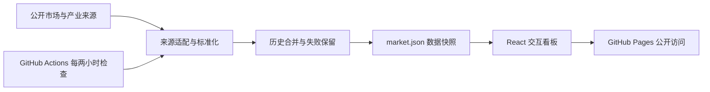

# 市场风险观察站

### 在同一个交互页面里观察金融市场与 AI 产业变化

基于 React、TypeScript、Recharts 和 Vite 的公开研究看板，整合市场指标、GPU 租金、AI 公司收入披露、Token 价格与云厂商财报信息。后台通过 GitHub Actions 定期检查来源、累积历史，前台负责比较与解释数据。

**[打开在线观察站](https://YangXiaoBo-YG.github.io/market-risk-refresh/) · [查看更新记录](https://github.com/YangXiaoBo-YG/market-risk-refresh/actions/workflows/refresh.yml) · [数据采集实现](web/lib/collect.mjs)**

## 用来做什么

- 把市场波动、利率与权益市场结构放在一起对照，而不是分散打开多个数据网站。
- 比较指数的等权与市值加权表现、回撤及时间区间，观察上涨是否集中在少数公司。
- 将 AI 产业研究中的 GPU 租金、Token 报价、收入披露和财报负担放入同一个工作台。
- 明确区分观测日期、检查日期与更新失败，避免把旧值当成新数据。

## 功能地图

| 模块 | 展示内容 | 阅读时要注意 |
|---|---|---|
| 市场指标 | IXG、MOVE、VIX、美债收益率、期限利差 | 来源、频率和可用历史并不相同 |
| 权益比较 | 标普与纳指等权 / 加权、广度、自由对比及回撤 | 指数口径不同，不直接等同于可投资组合收益 |
| GPU 市场 | H100、H200、B200 等公开租金窗口 | 历史由公开窗口逐步累积 |
| AI 商业化 | 公司收入 / ARR 披露、Token 报价 | 披露稀疏，不能视为连续日度经营数据 |
| 云厂商财报 | 财报指标与利息负担 | 以披露期间和来源说明为准 |

## 工程实现



采集任务遇到单个来源失败时保留该来源的上次有效值并记录错误；历史增量存入版本控制。网页读取最近生成的数据快照，刷新按钮不会强制云端任务立即执行。GitHub 的定时调度可能延迟。

## 项目体现的能力

将金融与 AI 产业研究需求转成可交互产品：指标选择与口径说明、来源适配、历史数据管理、分析视图，以及从采集到公开网页的自动更新链路。代码展示实现方式；未宣称预测准确率或投资收益。

## 我的角色：产品设计、研究与 Agent 协作

本项目由 YangXiaoBo-YG 从个人研究 / 使用需求出发主导产品定义，设计来源调查、数据核验、方法设计、工程实现与 UI 验收的 Agent 分工，通过人机协作持续迭代。重点是把研究问题转化为可运行、可检查的产品，并对来源与结果作最终判断。

**[产品设计与职责](docs/PRODUCT_PRD.md) · [Agent 协作与数据核验](docs/AGENT_WORKFLOW.md) · [简历 / 面试说明](docs/RESUME.md)**

以 MOVE × SPX 为例：提出债市波动与股市回撤的联动 / 背离问题，实现共同日期、历史分位和回撤对照。当前是描述性研究工具，不把它写成稳定反比或已验证预测规律。见 [研究说明](docs/RESEARCH_MOVE_SPX.md)。

职责说明区分 Agent 辅助开发 / 核验与生产脚本自动执行，实际运行结果以任务记录和代码验证为准。

## 本地启动

需要 Node.js 22 与 npm。

```powershell
cd web
npm ci
npm run dev
```

生产检查与构建：

```powershell
npm run build
```

该命令先执行 TypeScript 检查，再构建静态页面。若要运行云端采集，请先阅读 [工作流](.github/workflows/refresh.yml) 和 [采集入口](scripts/refresh-public.mjs)，不要将个人身份信息写入源码。

## 仓库导航

| 路径 | 内容 |
|---|---|
| `web/app/` | 市场、权益、财报、价格等交互模块 |
| `web/lib/collect.mjs` | 来源定义、标准化、历史合并与采集 |
| `web/lib/analytics.ts`、`risk-methods.ts` | 分析计算与指标方法 |
| `web/public/data/market.json` | 最近一次保存的数据快照 |
| `scripts/refresh-public.mjs` | 云端更新入口 |
| `.github/workflows/refresh.yml` | 定时采集、构建和 Pages 发布 |

## 数据与使用边界

来源和观测日期在网页注明。财报、收入与 ARR 不是每日披露；GPU 数据来自 Silicon Data 公开窗口，公开可见不代表取得商业再分发授权。项目不提供每日信用 OAS，目前没有信用利差模块。仅供研究参考，不构成投资建议。

SEC 请求身份通过仓库 Secret `SEC_USER_AGENT` 配置，不写入前端、数据文件或 README。仓库与网站公开，不代表 GitHub Secrets 公开。

## 相关个人项目

[Anatomy Video 技术视频工作流](https://github.com/YangXiaoBo-YG/anatomy-video) · [PhDHunter 博士求职平台](https://github.com/YangXiaoBo-YG/phdhunter-showcase)
